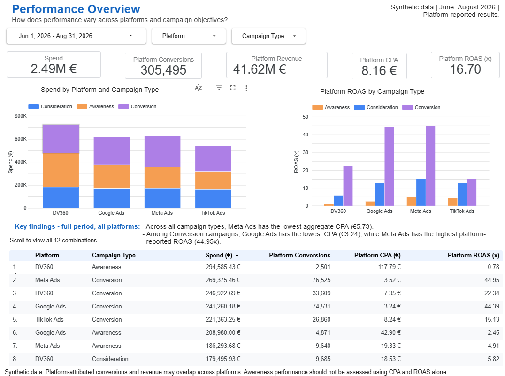
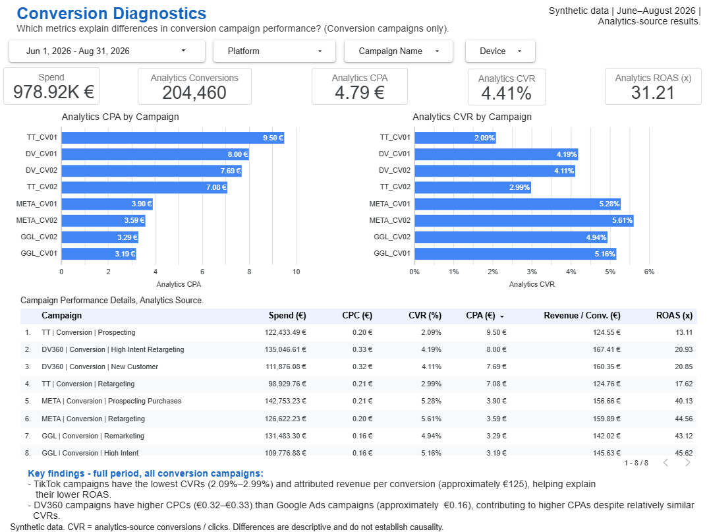
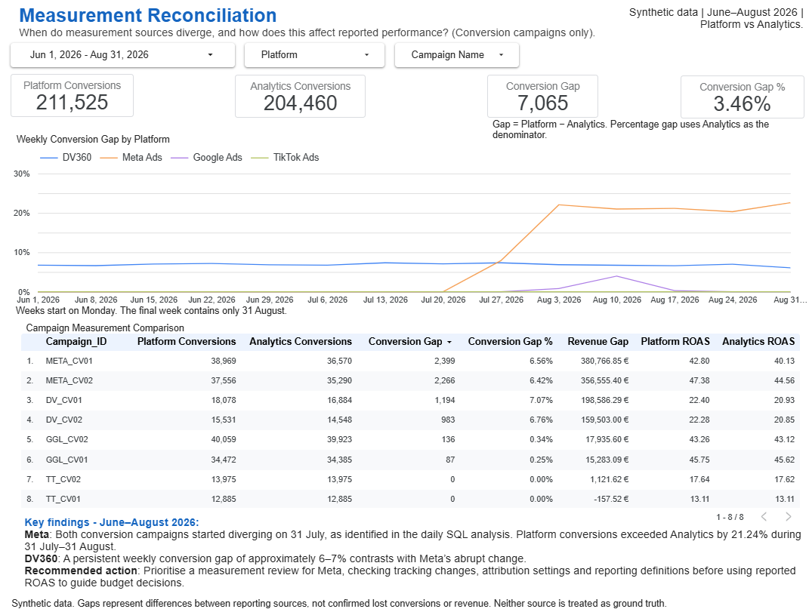

# Marketing Performance and Measurement Analysis.

An end-to-end marketing analytics project using Python, DuckDB SQL and
Looker Studio to compare campaign performance and investigate differences
between platform and analytics reporting.

**Dataset:** Synthetic data covering June–August 2026.
**Scope:** 6,624 records, 24 campaigns, four advertising platforms.

[Explore the interactive dashboard](https://datastudio.google.com/s/nxXR821mqs4)
 · [View the analysis notebook](notebooks/marketing_performance_analysis.ipynb)

## Business questions

1. How does platform performance change when campaigns are compared
   within the same funnel stage?
2. Which metrics help explain differences in conversion campaign CPA
   and ROAS?
3. When do reporting sources diverge, and how does this affect
   reported performance?

## Key findings

- **Campaign objectives change the ranking.** Meta Ads has the lowest
  platform-reported CPA across all campaign types (€5.73). Among
  Conversion campaigns, Google Ads leads at €3.24, followed by Meta
  Ads at €3.52.

- **TikTok's conversion campaigns show lower reported conversion rates
  and revenue per conversion.** Using the analytics source, their CVRs
  are 2.09% and 2.99%, with revenue per conversion around €125.
  These metrics help explain their lower ROAS.

- **Both Meta Conversion campaigns begin reporting different conversion
  counts across sources on 31 July.** From 31 July to 31 August,
  platform conversions exceed analytics conversions by 4,665 (21.24%).
  For META_CV01, reported ROAS is 43.91 using platform data versus
  36.10 using analytics data.

These findings support comparing campaigns by objective and reviewing
measurement consistency before making budget recommendations.

## Workflow

1. **Python and pandas:** Load the data, convert dates and check missing
   values, duplicate keys, negative metrics and campaign-day consistency.
2. **DuckDB SQL:** Aggregate performance by platform and funnel stage,
   analyse conversion campaigns and investigate weekly and daily gaps.
3. **Data export:** Prepare a 14-column CSV for Google Sheets and
   Looker Studio.
4. **Looker Studio:** Present the results across three interactive pages:
   Performance Overview, Conversion Diagnostics and Measurement
   Reconciliation.

## Data and validation

Each row represents one date, campaign and device combination.
The dataset covers Google Ads, Meta Ads, TikTok Ads and DV360.

The corrected dataset contains:
- 6,624 records and 2,208 campaign-day combinations.
- Three distinct devices per campaign-day.
- No missing values or duplicate date–campaign–device keys.
- No negative values in the tested performance metrics.
- No campaign-day spend above the synthetic budget cap.

During preparation, repeated spend values across device rows were
identified. The synthetic dataset was revised to allocate campaign-day
spend across devices. The analysis uses this corrected version.

Daily budget is repeated across devices and must be counted once per
campaign-day. It is excluded from the dashboard export to avoid
double counting.

## Metric definitions

Ratios are calculated from aggregated totals, rather than averaging
row-level ratios.

| Metric | Calculation |
|---|---|
| CPA | Spend / Conversions |
| ROAS | Attributed revenue / Spend |
| CPC | Spend / Clicks |
| CVR | Reported conversions / Clicks |
| Revenue per conversion | Attributed revenue / Conversions |
| Conversion gap | Platform conversions − Analytics conversions |
| Conversion gap % | Conversion gap / Analytics conversions × 100 |

Platform and analytics metrics are labelled separately.
CVR is a reported-conversions-to-clicks ratio, not a verified
post-click conversion rate.

## Dashboard pages

### Performance Overview
Compare spend, CPA and ROAS across platforms and campaign objectives.

### Conversion Diagnostics
Compare campaign CPA, CVR, CPC and attributed revenue per conversion.

### Measurement Reconciliation
Explore weekly reporting gaps and compare source-specific campaign results.

## Repository contents

| Location | Contents |
|---|---|
| `notebooks/` | Python preparation, SQL analysis, outputs and interpretations |
| `data/marketing_performance_raw_jun_aug_2026.csv` | Corrected synthetic dataset used in the analysis |
| `data/marketing_dashboard_jun_aug_2026.csv` | Dataset exported for the dashboard |
| `images/` | Dashboard screenshots |

## How to run

1. Download the analysis dataset from `data/`.
2. Open the notebook in Google Colab.
3. Upload the dataset to your Google Drive.
4. Update `data_path` in the loading cell to match its location.
5. Run the notebook from top to bottom and authorise the Drive mount.

The notebook installs DuckDB, loads the data with pandas and exports
the dashboard CSV to the same folder as the input dataset.

## Limitations

- All data is synthetic and does not represent client results or
  industry benchmarks.
- Findings are descriptive and do not establish causality,
  incremental sales or the return from increasing spend.
- Neither reporting source is assumed to be ground truth.
- Attributed conversions and revenue may overlap across platforms.
  Combined totals should not be interpreted as unique business outcomes.
- Reporting gaps do not represent confirmed lost conversions or revenue.
- The week beginning 31 August contains only one day of data.

## Display notes

Number formatting may vary between viewing environments, including
decimal and thousands separators, currency placement and compact notation.
All monetary values are in EUR. K and M denote thousands and millions.
Dashboard screenshots show the formatting used during validation.
